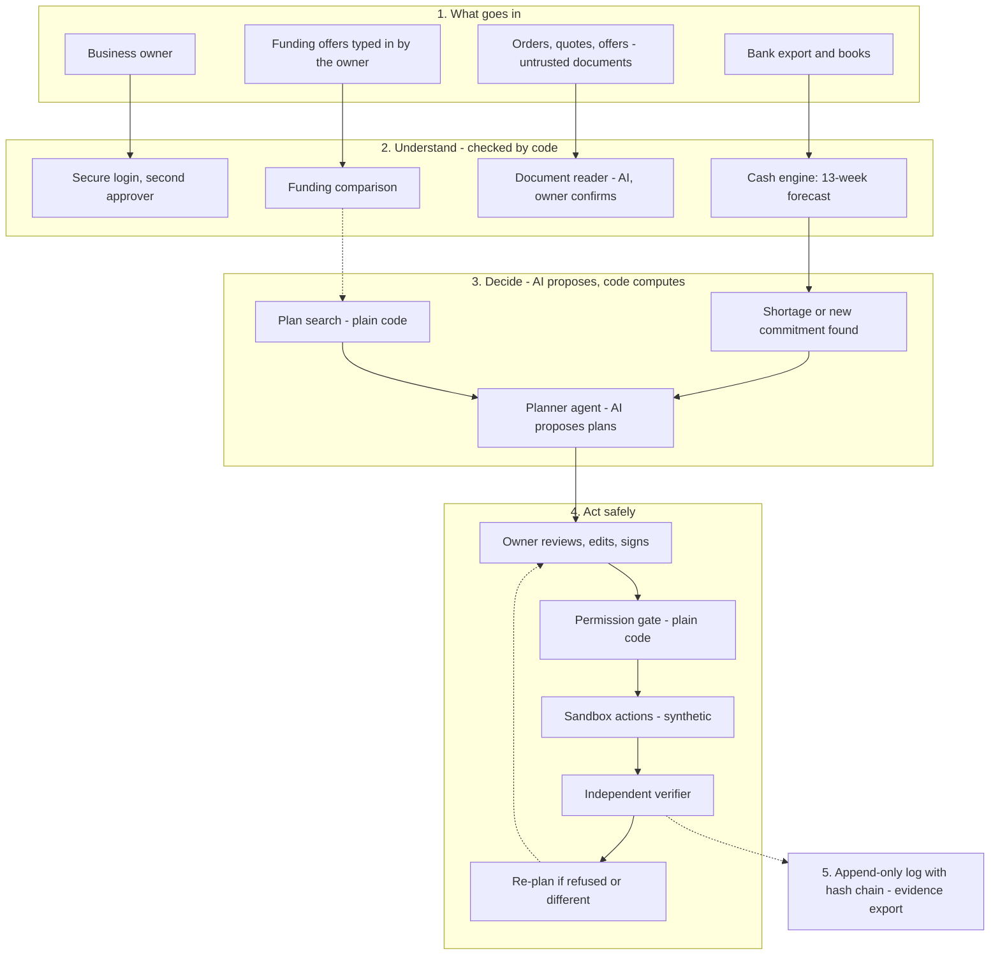

# SME Finance Copilot: how the system works (for anyone)

Status: 2026-10-16. All demo data is **synthetic**. No real money, no real credentials.

## 1. What it is, in one minute

Small business owners run out of cash because money arrives late and bills do not. Most tools show a chart. This one **does something about it**, but only inside limits the owner signs.

When it sees a cash shortage coming, or when the owner receives a big new order, it:

1. works out why the gap exists,
2. proposes two or three ways to fix it,
3. waits for the owner to review, edit and sign,
4. carries the plan out in a **sandbox** (a fake bank with simulated customers, suppliers and lenders),
5. checks that it really worked, and changes the plan if something went differently,
6. writes everything to a log that cannot be edited.

**The one rule that shapes everything:** the AI may *suggest*, but plain code does all the maths and decides what is allowed. The AI never moves money and never approves itself.

## 2. The picture

The Excalidraw figure shows the same flow in five bands: what goes in, understand, decide, act safely, proof. The figure was drawn in the session; to keep an editable copy, open it in Excalidraw and save it as `docs/system-overview.excalidraw`. A text version of it follows, so the repository never depends on that file.

## 3. A worked story

Nadia runs a 14-person packaging distributor (an invented example). A grocery chain sends a £180,000 order on 60-day payment terms. Her supplier wants a 30% deposit now and the balance at shipment. She has £42,000 in the bank and payroll every two weeks.

- She uploads the order and the supplier quote. The **document reader** pulls out the amounts and dates. A separate scan looks for text that tries to give instructions. She confirms the key figures herself.
- The **cash engine** shows a hole in about week 5 and ranks what causes it: the supplier balance, the supplier deposit, and a customer who always pays late.
- The **planner** offers plans such as "ask the buyer for a 20% deposit, apply for invoice finance, ask a slow payer to pay sooner". Code computes the cash effect of each plan. The model supplies no numbers.
- She edits a term, reads and adjusts the letters to each counterparty, then **signs** with her password and a drawn signature. Because the payments are large, the plan then waits: a second person with an approver account signs in as themselves and confirms it with their own password. Nobody ever types another person's password.
- The system sends the proposals. The buyer will only give a 10% deposit, which is outside what she signed. The system **stops, rolls back and tells her**. She revises the terms herself or asks the agent to re-plan inside what the buyer accepts.
- After the new plan runs, an **independent verifier** recomputes the forecast from the terms actually agreed and compares it with what was promised. A difference is reported plainly.

## 4. The parts, one by one

| Part | What it does | Who is in charge |
|---|---|---|
| Import and books | Reads bank CSVs, invoices, bills, recurring costs; reconciles them | Code |
| Cash engine | 13-week forecast, reserve, shortage date, causes ranked, what-if scenarios | Code |
| Document reader | Extracts terms from orders and quotes into a strict form; flags anything made up | AI inside a box (no tools), then code validates |
| Planner | Proposes plans from a search that code ran | AI proposes, code computes and checks |
| Mandate | The limits the owner signs: payment size, daily total, who may be paid, allowed actions | The owner (cryptographic signature) |
| Permission gate | Allows or refuses every single action against the signed limits | Code only |
| Sandbox | Fake bank and simulated customers, suppliers and lenders with different behaviours | Simulation |
| Verifier | Re-checks that actions happened and that the outcome matches the promise | Code, separate from the executor |
| Log and evidence | Append-only, hash-chained record; exportable and checkable offline | Database rules + code |

## 5. Why it can be trusted

- **Money is whole numbers** in the smallest unit (pence), with the currency attached. Never decimals or floating point.
- **Text from outside is data, not instructions.** Documents, emails and counterparty messages cannot make the system do anything. An order that says "ignore your limits" is flagged and ignored.
- **The AI is boxed in.** It never receives raw counterparty text, cannot call tools while reading documents, and cannot import the code that signs or approves. A code-style rule (ESLint) enforces this.
- **Limits live in code, not in prompts.** Even a manipulated model cannot exceed what the owner signed.
- **Everything is logged** in a chain where changing one record breaks all later ones.
- **Passwords step-up and two people** are needed for approvals; cookies, CSRF and rate limits are in place.

## 6. Funding options (new)

The owner types in offers from lenders, or reads them from the lender's own document. For each offer the system shows, with plain code:

- **Total cost** (everything repaid minus the money actually received) and cost as a share of the amount borrowed.
- **Two yearly cost figures** so offers of different lengths can be compared. One is a simple average-balance figure; the other is a compounded "effective annual rate" from the actual dates. Both are **estimates for comparison, not the lender's legal APR**. Very short terms compound to meaningless numbers and are reported as such.
- **The effect on cash** week by week, against **not borrowing**, which is always shown first.
- **Debt service coverage**: cash the business makes from operations divided by all scheduled repayments, including loans already planned. Lenders typically look for about 1.25 or more, so below that the system warns.
- **Repayments past the forecast window**: the cost covers the whole loan, the cash view only 13 weeks, and the screen says so.
- **Taking several offers together**, to show stacking.

The owner screen is at Funding in the navigation. Offers can be saved; the planning agent can then read the figures (never the lender's name). The owner can sign a ceiling on yearly cost and on the amount from one lender, and when a lender sends its contract the owner types in what it says and plain code lists every difference from the offer. Still to build: reading the contract document automatically, and a loan application that the permission gate would hold to these limits.

## 7. What is real and what is simulated

| Real (built and tested) | Simulated |
|---|---|
| Forecast, plan search, gate, signatures, log, verifier, evidence export, funding comparison maths | Bank, customers, suppliers and lenders in the sandbox |
| Document reading and the safety scan | The counterparties' replies and personalities |
| Owner login, step-up, letters, signature | Money movement |

Real data can be imported (CSV, documents, typed offers). Nothing here contacts a real bank or lender, and that should not change without a separate security review.

## 8. Where to look

- Strategy and scoring: `docs/product-strategy.md`
- Feature status and phases: `docs/spec-sheet.md`
- Decisions: `docs/decisions.md`; security model: `docs/security-model.md`
- Demo script: `docs/demo-script.md`; run it offline with `bun run demo`
- Checks: `bun run check:engine | check:gate | check:plan | check:financing | e2e:smoke`
